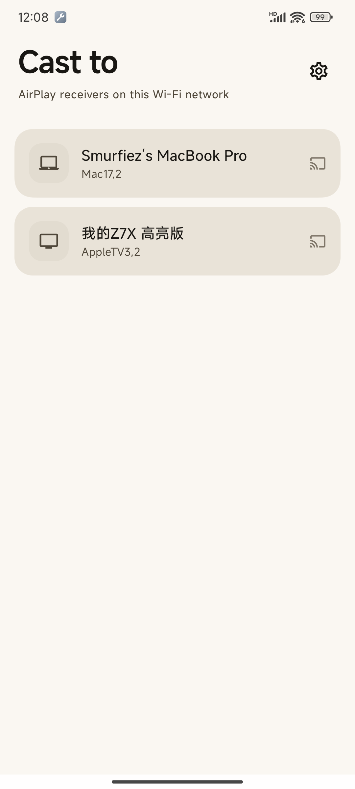
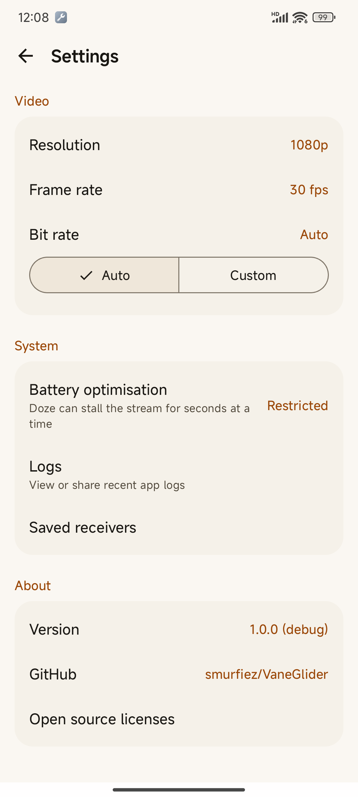

# VaneGlider

Android AirPlay sender. Mirrors your phone's screen — and plays its sound — on
a Mac, Apple TV, or any AirPlay receiver.

A fork of [Kite](https://github.com/itsHenry35/Kite) by Henry, with fixes for
third-party receivers, phone-audio muting and a new visual identity.

[English](README.md) | [简体中文](README.zh-CN.md)

## Releases

[](https://github.com/smurfiez/VaneGlider/releases)

## Screenshots

<p align="center">
  
  
</p>

## Features

- Mirror your screen to a Mac, Apple TV, or any AirPlay receiver
- Sound included: long-press a receiver to choose screen with sound, screen
  without sound, or sound only
- One-time pairing on Mac and Apple TV — enter the PIN shown on screen once,
  then every connection just works
- Adjustable resolution, frame rate and bit rate (up to 200 Mbps)
- Finds receivers on your Wi-Fi automatically, including open receivers like
  UxPlay and Android-based projectors
- Casting details (resolution, frame rate, bit rate) live in the ongoing
  notification, so the app screen stays on the receiver list
- The phone's media volume is muted for the length of a cast and restored when
  it ends — including after a crash or a force-stop
- Quick Settings tile and one-tap log sharing

## What this fork changes

- **Third-party receivers whose AirPlay and RAOP advertisements use different
  ports.** Apple sends AirPlay 1 mirroring over the RTSP server announced by
  `_raop`, but Kite always dialled the `_airplay` port. Receivers such as XGIMI
  projectors publish a stub there that answers every RTSP method with an empty
  `200 OK`, so `POST /fp-setup` came back with zero bytes and the cast died with
  `m2: length 0, want 142`. Discovery now adopts the `_raop` RTSP port for the
  same host (gated on the RAOP `ft` mask claiming mirroring), which also folds
  the duplicate "Audio only" row into the single receiver.
- **No more double audio.** Playback capture taps the audio without owning it,
  so the phone kept playing everything the receiver was also getting. The media
  stream is now muted while an audio-carrying cast runs, and the pre-cast level
  is persisted so a killed process still restores it on the next start.
- **New identity.** Warm ink neutrals with a single amber "on air" accent
  instead of the system-generated palette, tighter typography with monospaced
  metrics, compact headers on every screen, and contrast-checked colour pairs
  in both light and dark themes.
- **Live state where it belongs.** The status panel now appears only for
  connecting, pairing and failures; while casting, the ongoing notification
  shows `864 × 1920 @ 30 fps · 1.4 Mbps` and the app screen is just the
  receiver list plus Stop.

## Requirements

- Android 10 or later (minSdk 29)
- A real device on the same Wi-Fi network as the receiver
- An AirPlay receiver

## Building

```sh
./gradlew :app:assembleDebug
```

The Android SDK is located through `ANDROID_HOME` or `local.properties`.

## Acknowledgements

VaneGlider builds on years of open-source AirPlay work, and on Kite itself.
Thanks to:

- [Kite](https://github.com/itsHenry35/Kite) — the upstream Android AirPlay
  sender this fork is based on
- [doubletake](https://github.com/omarroth/doubletake) — Go AirPlay sender;
  parts of the protocol layer are Kotlin ports of it
- [UxPlay](https://github.com/FDH2/UxPlay) — open-source AirPlay receiver; a
  key reference during development
- [pyatv](https://github.com/postlund/pyatv) — AirPlay 2 protocol reference
- [shairport-sync](https://github.com/mikebrady/shairport-sync) — pairing and
  timing reference
- [openairplay](https://github.com/openairplay/airplay-spec) — early protocol
  documentation

## License

VaneGlider is released under the GNU LGPL-3.0 — see [LICENSE](LICENSE). Ported
files carry doubletake's license. Open-source attributions are also listed in
the app under Settings → About.
