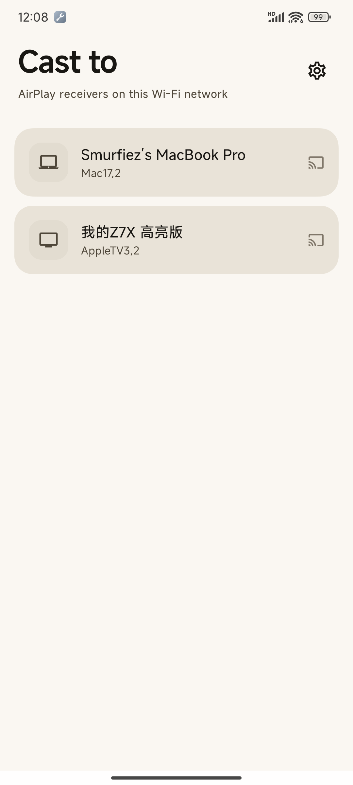
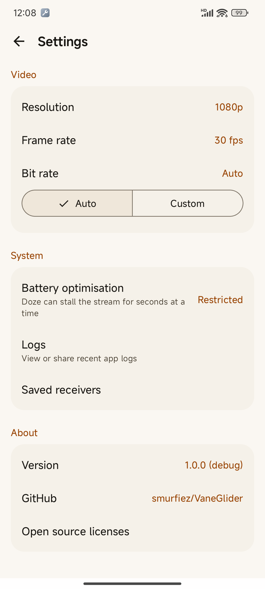

# VaneGlider

把 Android 屏幕和屏幕上播放的声音投到 Mac、Apple TV 或其他 AirPlay 接收端。

[English](README.md) | 简体中文

[安装](#安装) · [兼容性](#接收端兼容性) · [故障排查](#故障排查)

## 截图

  
  

## 功能

- 支持画面和声音、仅画面、仅声音三种投放方式
- 自动发现 AirPlay 接收端，也兼容 UxPlay 等开源接收端和 Android 投影仪
- 与 Mac、Apple TV 首次配对后自动连接，也支持接收端的 AirPlay 密码
- 可调节分辨率、帧率和码率，适应网络状况
- 在「画面和声音」和「仅声音」模式下静音手机媒体音量，结束后恢复，即使应用崩溃也能恢复
- 快捷设置磁贴、通知栏控制、可分享日志

## 安装

### 要求

- Android 10 及以上
- 手机与 AirPlay 接收端连接同一 Wi-Fi 网络
- 接收端支持你想使用的投放模式

### 下载

- [下载最新的已签名 APK](https://github.com/smurfiez/VaneGlider/releases/download/v2.1.0/VaneGlider-2.1.0.apk)
- [查看所有发行版](https://github.com/smurfiez/VaneGlider/releases)

打开下载的 APK。若 Android 提示，请允许浏览器或文件管理器安装未知应用，然后确认安装。

> **从 Kite 升级？** VaneGlider 2.0 使用新的应用 ID 和签名密钥，因此会与原来的 Kite 应用并存安装，而不是覆盖升级。

## 首次投放

1. 在 Mac、Apple TV 或其他接收端上打开 AirPlay 接收功能，并让它和手机连接同一 Wi-Fi 网络。
2. 打开 VaneGlider，授予请求的权限：
   - **麦克风**：Android 通过该权限授权应用内录，不会录制麦克风输入
   - Android 12 及以上的**附近设备**：用于蓝牙发现；Android 13 及以上还用于搜索局域网接收端
   - Android 10–11 的**位置信息**：用于蓝牙发现
   - Android 13 及以上的**通知**：用于显示投放状态和控制按钮
3. 点按支持镜像的接收端会以「画面和声音」开始投放；若接收端不支持音频，则会以无声画面开始。点按仅音频接收端会以「仅声音」开始。长按 Mac、Apple TV 或其他同时支持镜像和音频的接收端可选择其他模式。
4. 允许 Android 的屏幕录制请求。每次投放都需要授权，仅声音模式也一样，因为画面和声音使用同一个授权。
5. 如果是首次连接且接收端显示配对码，输入四位配对码；若接收端设置了 AirPlay 密码，也请输入。
6. 在 VaneGlider 或常驻通知中停止投放。

配对会被记住，但每次新的投放仍需授予 Android 的屏幕录制权限。

## 投放模式

| 模式 | 作用 |
|---|---|
| **画面和声音** | 镜像手机屏幕，并把手机上播放的声音发送到接收端。 |
| **仅画面** | 镜像手机屏幕，但不发送声音。手机本地播放不受影响。 |
| **仅声音** | 只发送手机声音，不镜像屏幕。 |

点按支持镜像的接收端会以**画面和声音**开始投放。若接收端接受镜像但拒绝音频，投放会继续，但不会发送声音。仅音频接收端点按后会以**仅声音**开始。长按同时支持镜像和音频的接收端可选择模式；仅镜像和仅音频接收端没有模式菜单。两种能力都不支持的接收端保持禁用。

内录会旁路抓取声音，手机本身仍会播放，因此在「画面和声音」和「仅声音」模式下，VaneGlider 会静音手机媒体音量，避免两台设备同时出声；投放结束（包括应用崩溃）后恢复原音量。

## 接收端兼容性

AirPlay 的实现因接收端和软件版本而异。下表列出 VaneGlider 为各类接收端支持的连接路径；实际行为仍可能因型号和固件而异。接收端也可能在配对之外，或代替配对，要求输入 AirPlay 密码。

| 接收端 | 画面和声音 | 仅画面 | 仅声音 | 说明 |
|---|:---:|:---:|:---:|---|
| **Mac** | ✓ | ✓ | ✓ | 首次需要输入 PIN 配对 |
| **Apple TV** | ✓ | ✓ | ✓ | 首次需要输入 PIN 配对 |
| **UxPlay 等开源接收端** | ✓ | ✓ | ✓ | 可能需要旧版配对或 AirPlay 密码 |
| **Android 投影仪及其他 AirPlay 1 镜像接收端** | 视情况 | ✓ | 视情况 | 取决于接收端是否声明音频支持 |
| **HomePod 等 AirPlay 2 纯音频接收端** | — | — | ✓ | 仅支持音频 |
| **经典 AirPlay（RAOP）音箱** | — | — | ✓ | 仅支持音频；可能需要 AirPlay 密码 |

## 设置与画质

### 分辨率

可选**原生**、**1080p**、**720p** 或 **540p**。原生最清晰，也最耗编码资源；降低分辨率可减少带宽和编码压力。默认 1080p。

### 帧率

可选 **24**、**30**、**60**、**90** 或 **120 fps**。默认 30 fps。帧率越高画面越流畅，但占用更多带宽。

### 码率

保持**自动**会根据所选分辨率调整画面码率；也可以自定义 **2–200 Mbps**。自定义模式从 30 Mbps 开始。码率越高细节越多，但对网络要求也越高。

投放期间，常驻通知会显示实际使用的分辨率、帧率和码率。

### 电池优化

省电模式（Doze）可能让画面卡顿数秒。如果 VaneGlider 在后台或息屏时出现卡顿，请打开**设置 → 电池优化**并允许忽略电池优化。

### 已保存的接收端

配对信息保存在**设置 → 已保存的接收端**。取消配对后，下次连接需要重新配对。

### 日志

在**设置 → 日志**中查看或分享最近的应用日志。报告投放问题时请附上日志，其中包含接收端型号和会话信息。

## 故障排查

### 找不到接收端

- 确认手机和接收端连接同一个 Wi-Fi 网络。
- 确认接收端已开启 AirPlay 接收功能。
- Android 13 及以上请允许**附近设备**以搜索局域网接收端。
- Android 12 及以上请允许**附近设备**以进行蓝牙发现；Android 10–11 请允许位置信息。
- 访客网络以及路由器的 AP 隔离或客户端隔离会阻止本地发现。

### 屏幕录制或权限失败

Android 每次投放都会重新请求屏幕录制权限。如果提示被关闭或授权失效，请重新开始投放并允许。若需要声音，也请确认已授予麦克风权限。

### 没有声音

- 请选择**画面和声音**，而不是**仅画面**。
- 确认已授予麦克风权限；Android 使用该权限授权内录，但不会录制麦克风输入。
- 调高接收端音量；在「画面和声音」和「仅声音」模式下手机媒体音量会被静音。
- 部分应用会有意禁止 Android 抓取其音频，因此通过 AirPlay 投放时仍会静音。

### 卡顿、延迟或频繁断开

- 在 VaneGlider 设置中允许忽略电池优化。
- 降低分辨率、帧率或码率。
- 让手机和接收端靠近路由器，或换用更空闲的 Wi-Fi 网络。

### 配对失败

- 输入接收端屏幕上显示的四位配对码；接收端也可能要求 AirPlay 密码。
- 如果失败次数过多导致配对被暂时限流，请关闭再打开接收端的 AirPlay 功能，或等待约 30 分钟。
- 如果 VaneGlider 提示配对信息已失效，请打开**设置 → 已保存的接收端**，取消该接收端的配对后重新配对。

### 接收端结束会话

确认接收端已唤醒、联网，并且没有正在进行的其他 AirPlay 会话。较旧或功能受限的接收端可能不支持所选投放模式。

### 投放模式不可用

对于既不支持镜像也不支持音频的接收端，VaneGlider 会将其禁用。标记为**不支持镜像**的接收端仍会显示在列表中，但不能接收画面。

### 报告问题

请前往 [GitHub Issues](https://github.com/smurfiez/VaneGlider/issues) 并附上：

- VaneGlider 版本
- 接收端类型和型号
- 你期望的结果与实际发生的情况
- **设置 → 日志**中的日志包

## 项目

VaneGlider 是 [Kite](https://github.com/itsHenry35/Kite) 的分支，修复了第三方接收端兼容性、手机重复出声等问题，并采用了新的视觉风格。发行说明见[更新日志](CHANGELOG.md)。

- [参与贡献与技术设计](CONTRIBUTING.md)
- [报告问题](https://github.com/smurfiez/VaneGlider/issues)
- [所有发行版](https://github.com/smurfiez/VaneGlider/releases)

## 致谢

VaneGlider 建立在多年开源 AirPlay 工作之上，也建立在 Kite 之上。感谢：

- [Kite](https://github.com/itsHenry35/Kite) —— 本分支基于的上游 Android AirPlay 发送端
- [doubletake](https://github.com/omarroth/doubletake) —— Go 实现的 AirPlay 发送端；协议层部分代码移植自该项目
- [UxPlay](https://github.com/FDH2/UxPlay) —— 开源 AirPlay 接收端；开发过程中的主要参考
- [pyatv](https://github.com/postlund/pyatv) —— AirPlay 2 协议参考
- [shairport-sync](https://github.com/mikebrady/shairport-sync) —— 配对与时间同步参考
- [openairplay](https://github.com/openairplay/airplay-spec) —— 早期协议文档

## 许可

VaneGlider 以 GNU LGPL-3.0 发布，见 [LICENSE](LICENSE)。移植代码沿用 doubletake 的许可。开源声明也可在应用内「设置 → 关于」中查看。
